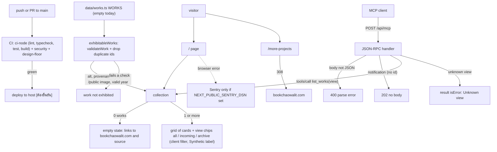
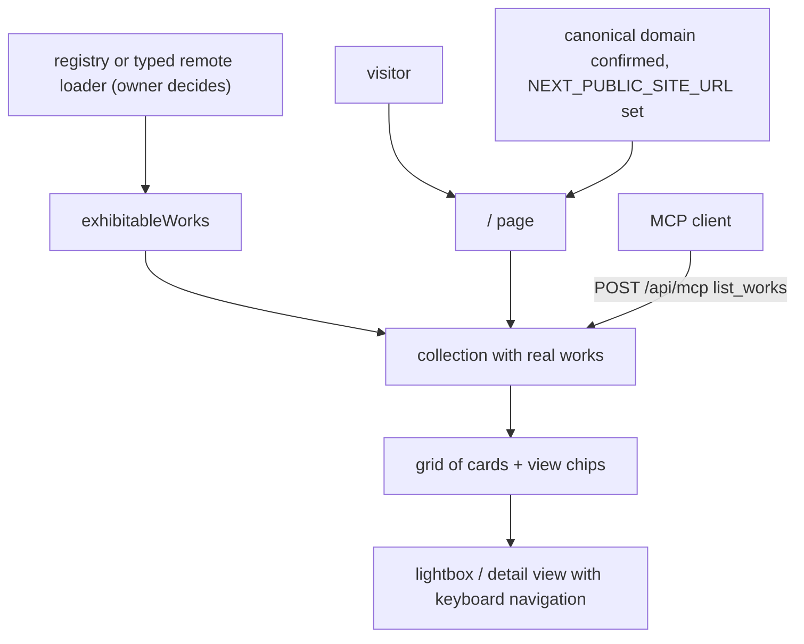

# 01 — Business process (As-Is / To-Be)

ai-art-gallery-web คือหน้าแกลเลอรีงาน AI art ที่แสดงเฉพาะงานที่ลงทะเบียนใน `data/works.ts` พร้อม alt text และ provenance ตอนนี้ทะเบียนว่างจึงแสดง empty state; มี endpoint `/api/mcp` อ่านอย่างเดียวให้ agent ดึงรายการงาน ผู้ใช้คือผู้เข้าชมทั่วไปและ agent

Last reviewed: 2026-11-28 · commit `259866b`

## As-Is (จากโค้ดวันนี้)

Sources: `app/page.tsx`, `components/gallery-view.tsx`, `data/works.ts`, `lib/gallery.ts`, `lib/mcp.ts`, `app/api/mcp/route.ts`, `next.config.ts`, `app/robots.ts`, `app/sitemap.ts`, `app/opengraph-image.tsx`, `lib/site.ts`, `instrumentation-client.ts`, `.github/workflows/ci.yml`, `README.md`, `PRODUCT.md`, `docs/UPGRADE-PLAN.md`

ข้อเท็จจริงสำคัญจากโค้ด:

- `WORKS` เป็น array ว่างใน repo; ไม่มี loader จากแหล่งภายนอก ไม่มี API เขียน ไม่มี database
- `validateWork` ปฏิเสธงานที่ไม่มี id/title/alt/provenance, imageUrl ที่ไม่ใช่ https หรือ path ใต้ `/public` (รวม `//host`), และปีนอก 1900–9999; id ซ้ำ (หลัง normalize) เหลืออันแรก
- `robots.ts` อนุญาต `/` และห้าม `/api/`; `sitemap.ts` มีหน้าเดียว (`SITE_URL`) โดย `SITE_URL` มาจาก `NEXT_PUBLIC_SITE_URL` หรือค่า default `https://ai-art-gallery.bookchaowalit.com`
- `/api/mcp` รับ POST เท่านั้น (ไม่มี GET handler ใน route)
- ที่ deploy จริงและ project บน host ไม่อยู่ใน repo [ต้องยืนยัน]

## To-Be (จาก docs/UPGRADE-PLAN.md)

Sources: `docs/UPGRADE-PLAN.md` (P1, P2)

## Gap

| ID | As-Is → To-Be | Status | Owner | Evidence |
|---|---|---|---|---|
| G1 | empty registry, empty state → first real works filed (or a remote source with a typed loader) | decide | owner | `docs/UPGRADE-PLAN.md` P1; `data/works.ts` is empty |
| G2 | default `SITE_URL` in code → canonical domain confirmed and `NEXT_PUBLIC_SITE_URL` set on the host | todo | owner | `docs/UPGRADE-PLAN.md` P1 |
| G3 | cards only → lightbox / detail view with keyboard navigation | todo | claude | `docs/UPGRADE-PLAN.md` P2 |

## Open questions

- `docs/UPGRADE-PLAN.md` ยังบอกว่า canonical fallback คือ URL ของ Vercel project แต่ `lib/site.ts` ใช้ `https://ai-art-gallery.bookchaowalit.com` เป็นค่า default (เอกสารตกค้าง)
- `specs/001-quality-floor/spec.md` R4 พูดถึงหน้า `/more-projects` แต่ route นี้เป็น redirect 308 ไปเว็บหลักแล้ว (`next.config.ts`)
